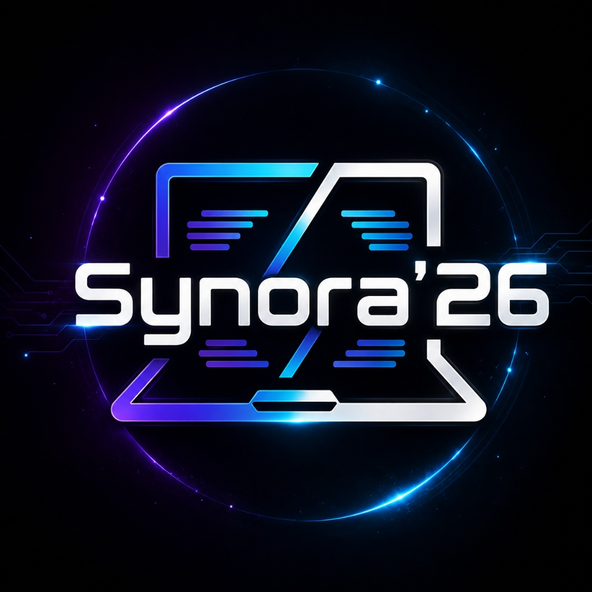

# 🚀 Synora '26 — National Innovation & Technology Hackathon

> Official portal for **Synora '26**, a national-level hackathon uniting student developers, innovators, and biotechnologists at **NEW SCAD, SIMATS Engineering, Chennai**.



---

## ⚡ Highlights & Key Telemetry

- **Date**: August 28, 2026 · 08:00 AM IST
- **Venue**: NEW SCAD, SIMATS Engineering, Chennai
- **Hacking Sprint**: 7 Hours Intensive Development
- **Cash Prize Pool**: ₹3,500 + Trophies, Certificates & Mentorship
- **Host Department**: Department of Medical Biotechnology, SIMATS Engineering
- **Portal Status**: Online Team Registrations Closed (Capacity Reached on August 25, 2026)

---

## 🛠️ Architecture & Tech Stack

This project was completely re-architected from a 500KB monolithic file into an ultra-fast, modern component-driven SPA:

- **Core Framework**: [React 18](https://react.dev/) + [TypeScript](https://www.typescriptlang.org/)
- **Bundler & Dev Server**: [Vite 6](https://vitejs.dev/) with tree-shaking & code splitting
- **Styling**: [Tailwind CSS 3](https://tailwindcss.com/) with a custom Cyber-Neon dark theme
- **Icons**: [Lucide React](https://lucide.dev/)
- **Canvas Visuals**: Custom high-performance 2D/3D constellation particle canvas with dynamic mouse interaction
- **Entry Pass System**: Dynamic ticket fetcher with JSONP fallback, live QR code generation, and PDF generation via [jsPDF](https://github.com/parallax/jsPDF)
- **Organizer Desk**: Built-in QR scanner powered by [Html5-QRCode](https://github.com/mebjas/html5-qrcode), manual attendance check-in, and telemetry dashboard
- **Celebration FX**: [Canvas Confetti](https://github.com/catdad/canvas-confetti)
- **CI/CD**: GitHub Actions automated workflow deploying pre-built artifacts to GitHub Pages

---

## 📁 Directory Structure

```text
hackathon-website/
├── .github/
│   └── workflows/
│       └── static.yml            # Automated GitHub Actions deployment
├── public/                       # Static public assets (copied directly to dist)
│   ├── _redirects                # SPA redirect rules (Netlify/Cloudflare)
│   ├── admin.html                # Backward-compatibility redirect to /#admin
│   ├── pass.html                 # Backward-compatibility redirect to /#pass
│   ├── favicon.ico
│   ├── indusind_qr.png
│   ├── logo.jpg
│   └── whatsapp_qr.png
├── src/
│   ├── components/
│   │   ├── admin/
│   │   │   └── AdminDeskView.tsx # Passcode gate & camera QR check-in scanner
│   │   ├── home/
│   │   │   ├── About.tsx         # Innovation lifecycle & 4 core pillars
│   │   │   ├── CanvasBackground.tsx # Interactive constellation particle canvas
│   │   │   ├── ContactSection.tsx# Tech lead & student helpline coordinators
│   │   │   ├── CustomCursor.tsx  # Dual-ring cybernetic cursor follower
│   │   │   ├── FAQ.tsx           # Accordion FAQ & WhatsApp community widget
│   │   │   ├── FacultyCoordinators.tsx
│   │   │   ├── FacultyOrganizers.tsx
│   │   │   ├── Hero.tsx          # Dynamic typewriter, live countdown HUD & stats
│   │   │   ├── Prizes.tsx        # Prize money & perks showcase
│   │   │   ├── RegistrationClosed.tsx # Official closure announcement & QR
│   │   │   ├── Stats.tsx         # Quick statistics counter bar
│   │   │   ├── TermsModal.tsx    # Official guidelines & non-refund policy
│   │   │   └── Tracks.tsx        # 5 innovation tracks with domain filter
│   │   ├── layout/
│   │   │   ├── Footer.tsx        # Footer with terms modal trigger
│   │   │   └── Navbar.tsx        # Sticky nav, scroll indicator & mobile drawer
│   │   └── pass/
│   │       └── DigitalPassView.tsx # Dynamic ticket verification & PDF badge
│   ├── data/
│   │   └── hackathonData.ts      # Centralized single source of truth
│   ├── services/
│   │   └── api.ts                # Google Apps Script API client with fallbacks
│   ├── types/
│   │   └── index.ts              # TypeScript domain types & interfaces
│   ├── App.tsx                   # Main application router
│   ├── index.css                 # Tailwind directives & neon glow utilities
│   └── main.tsx                  # React DOM root entry
├── index.html                    # Lightweight HTML5 entry (<2KB)
├── package.json
├── postcss.config.js
├── tailwind.config.js
├── tsconfig.json
├── tsconfig.node.json
└── vite.config.ts
```

---

## 🚀 Getting Started

### Prerequisites

- Node.js (v18.0.0 or higher)
- npm (v9.0.0 or higher)

### Installation

```bash
# Clone the repository
git clone https://github.com/kandukurijagan1/synora-26.git
cd synora-26

# Install dependencies
npm install
```

### Development Server

```bash
npm run dev
```

Visit `http://localhost:5173` in your browser.

### Production Build

```bash
npm run build
```

This checks TypeScript types and compiles the production bundle into the `dist/` directory.

### Preview Production Build

```bash
npm run preview
```

---

## 🎯 Key Application Features

1. **Integrated Digital Pass System**:
   - Participants can look up their registration by Team ID (e.g. `SYN-2609`) or leader email.
   - Generates a verified ticket with live QR code and dynamic team roster.
   - 1-click **Download Official PDF Pass** formatted as an A6 badge using `jsPDF`.

2. **Organizer Reception Desk**:
   - Access-restricted with passcode `SYNORA-ADMIN-2026`.
   - Real-time desk telemetry (Total Registered, Checked In, Pending).
   - In-browser camera QR code scanner with camera flipping support (`Html5Qrcode`).
   - 1-click manual attendance check-in and automated email sweep.

3. **Official Community Integration**:
   - Official WhatsApp group link and high-res QR code for participant broadcast.

4. **100% Backward Compatibility**:
   - Existing links to `pass.html?id=...` and `admin.html` redirect cleanly to the new unified SPA without breaking bookmarked URLs or QR codes.

---

## 👩‍💼 Leadership & Contacts

- **Overall Event Head & Main Tech Lead**: Kandukuri Jagan
- **Faculty Coordinators**: Dr. Sathya A B & Dr. Vijayalakshmi R
- **Faculty Leadership**: Dr. Ieshita Pan (HOD & Chief Organizer)
- **Student Helplines**:
  - Tharani: `+91 90149 78716`
  - Yugandhar: `+91 63023 89449`
  - Hemanth: `+91 63821 22447`

---

&copy; 2026 Department of Medical Biotechnology, SIMATS Engineering.